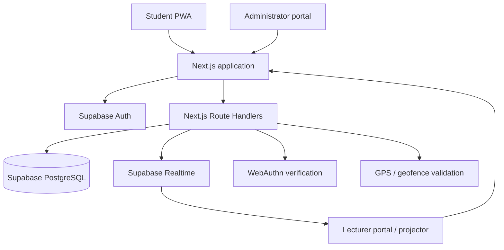

# University Attendance PWA

A Progressive Web App for managing university attendance across **students, lecturers, teaching assistants, and administrators**. The application combines rotating QR check-ins, WebAuthn passkeys, browser/PWA installation binding, GPS geofencing, multi-group lecture sessions, and live lecturer updates.

> **Project status:** MVP / controlled-pilot candidate. A successful local or hosted check-in is not, by itself, production approval.

---

## Contents

- [What the application does](#what-the-application-does)
- [Roles and permissions](#roles-and-permissions)
- [Architecture](#architecture)
- [Attendance check-in flow](#attendance-check-in-flow)
- [Teaching teams and multi-group sessions](#teaching-teams-and-multi-group-sessions)
- [Security model and limitations](#security-model-and-limitations)
- [Technology stack](#technology-stack)
- [Repository structure](#repository-structure)
- [Requirements](#requirements)
- [Run](#run)
- [Testing](#testing)
- [Operations and maintenance](#operations-and-maintenance)
- [Troubleshooting](#troubleshooting)

---

## What the application does

- **Student PWA:** today's classes, subject attendance summaries, attendance history, passkey/device setup, and camera-based QR check-in.
- **Lecturer portal:** assigned subjects, session creation, live attendance roster and counters, projector QR view, spot checks, manual attendance, and session controls.
- **Administrator portal:** account creation and suspension, subject/group/hall/timetable setup, teaching-team assignments, device recovery, review queue, audit history, and attendance exports.
- **Teaching teams:** each subject supports one professor and multiple teaching assistants.
- **Multi-group sessions:** a single lecture session can target one or several groups. A session covering two groups uses one session ID and one shared rotating QR code.
- **Passkey verification:** WebAuthn user verification is required during attendance authentication.
- **Location checks:** server-side distance and GPS-accuracy checks use the configured lecture-hall coordinates and policy.
- **Live updates:** the lecturer's control room receives private Supabase Realtime broadcasts and can reconcile with server data.
- **Installable PWA:** web app manifest, icons, service worker, mobile-safe layout, and automatic system light/dark appearance.
- **Operational controls:** rate limiting, audit events, review flags, daily raw-GPS retention maintenance, and health endpoint.

The app is designed for Android and iOS browsers/PWA installations. Desktop browsers are useful for development and testing; they are not a substitute for real-phone testing.

## Roles and permissions

| Account role | Main capabilities |
|---|---|
| `admin` | Manage accounts, groups, halls, subjects, teaching teams, enrollments, schedules, device recovery, reviews, and audit history. |
| `lecturer` | Access subjects to which the account is assigned as professor or teaching assistant; launch and manage sessions for those subjects. |
| `student` | View their own timetable and attendance, register passkeys, and check in to sessions that include their enrolled group. |

**Professor and teaching assistant are subject-level assignment types, not separate global account roles.** Both use the existing `profiles.role = 'lecturer'` account role. The `subject_staff.assignment_role` column determines whether that lecturer is the subject's `professor` or a `teaching_assistant`.

## Architecture



The application uses a single Next.js codebase. Next.js Route Handlers perform privileged server-side operations; Supabase provides authentication, PostgreSQL, row-level security, and Realtime. Rate limiting and temporary workflow state are database-backed;

### Core data model

| Table | Purpose |
|---|---|
| `profiles` | Application identity, university ID, name, role, and account status; references `auth.users`. |
| `student_groups` | Academic student groups. |
| `subjects` | Subject catalog and attendance threshold. `lecturer_id` remains as a compatibility field for the professor assignment. |
| `subject_staff` | Professor and teaching-assistant assignments for each subject. |
| `enrollments` | Student-to-subject/group membership; `(subject_id, student_id)` is the primary key. |
| `halls` | Lecture-hall coordinates, allowed radius, and maximum GPS accuracy. |
| `class_schedules` | Subject/group/hall timetable entries. |
| `sessions` | A live or historical lecture session, QR policy, status, and encrypted QR secret. |
| `session_groups` | Authoritative set of groups included in a session. |
| `attendance_attempts` | Per-student, short-lived WebAuthn challenges and attempt state. |
| `attendance_records` | Final present, late, review, or rejected attendance record. |
| `webauthn_credentials` | Public credential data and passkey metadata; private keys remain with the authenticator. |
| `device_installations` | Hashed browser/PWA installation identity and its assigned student. |
| `attendance_flags` | Suspicious or uncertain events that require review. |
| `reverification_challenges` / `reverification_responses` | Lecturer-issued in-room spot checks and student responses. |
| `audit_logs` | Append-only history of important administrative and attendance actions. |
| `rate_limits` | Database-backed request rate-limit state. |

### Compatibility fields

The teaching-team/multi-group migration keeps the older columns to support existing code and data during transition:

- `subjects.lecturer_id` is retained as a compatibility mirror of the professor assignment. `subject_staff` is the source of truth for teaching-team membership.
- `sessions.group_id` is retained as a compatibility mirror for a single-group session. `session_groups` is the source of truth for the selected group set; for a multi-group session, `sessions.group_id` is `NULL`.

Do not remove these legacy columns manually.

## Attendance check-in flow

1. A lecturer or assigned teaching assistant launches a session for a subject, hall, late threshold, and one or more enrolled groups.
2. The server creates one session secret and the projector displays a reusable HMAC-SHA256 QR token that rotates every **10 seconds** by default.
3. A student opens the in-app camera scanner and scans the live projector QR. The scanner does not present a gallery/file-upload option.
4. The server validates the QR token and creates an individual, single-use attendance attempt with a **45-second** WebAuthn challenge.
5. The student authenticates with a registered passkey. User verification is required; the server checks the signature, challenge, origin, and relying-party ID.
6. The browser obtains a high-accuracy geolocation fix. The server checks the reported accuracy and calculates distance to the configured hall using the geofence logic.
7. The server rechecks installation ownership and student eligibility for one of the groups selected for that session.
8. A database function consumes the attempt and inserts the attendance record atomically. Unique constraints prevent a student or browser installation from being recorded twice for the same session.
9. The lecturer's control room receives a Realtime update and reconciles the displayed count with server data.

The projector QR is intentionally **shared and reusable during its validity window** so one student does not consume it for everyone else. Single-use state is associated with each student's attendance attempt, not the shared QR token. The previous QR time bucket is accepted only during the short rollover grace implemented by the QR verifier.

If GPS quality is uncertain, the student may be offered a retry or a review path depending on the server policy. Uncertain GPS is not silently treated as a confirmed in-hall location.

## Teaching teams and multi-group sessions

### Assign teaching staff

1. Create professor and teaching-assistant accounts in **Admin → People**. Both accounts use role `lecturer`.
2. Create or open the subject in **Admin → Academics**.
3. Assign one professor and one or more teaching assistants in the Teaching team section.
4. To replace a professor, remove the current professor assignment before assigning the new one.

The database enforces at most one professor per subject. A subject may have multiple teaching assistants. Only administrators can change subject teaching-team assignments through the protected assignment operations.

### Start a session for one or multiple groups

1. The assigned professor or TA opens **Start session**.
2. Select the subject and lecture hall.
3. Select one or more groups that have enrolled students in that subject.
4. Set the late threshold and launch the session.

All selected groups share one session and one rotating QR code. A student is eligible only if their enrollment group is included in `session_groups`. Attendance summaries remain group-aware for each student.

An overlapping active session for the same subject/group combination is rejected transactionally. A session for a different group can run independently; a session that includes both groups conflicts with an active session covering either selected group.

## Security model and limitations

The system uses multiple controls. None should be described as absolute proof of physical presence or as impossible to bypass.

- **Rotating QR:** HMAC-SHA256 token, server-derived time bucket, 10-second default period, and a short previous-bucket rollover grace. A live QR can still be relayed in real time; rotation mainly limits stale screenshots and delayed sharing.
- **WebAuthn:** `userVerification: required` at registration/authentication and server-side verification of the expected challenge, origin, RP ID, and signature. A valid passkey proves control of a credential with local user verification; it does not by itself prove the person is in the lecture hall.
- **Geofencing:** the server calculates distance from reported browser coordinates and applies hall-specific radius and accuracy limits. Browser GPS can be inaccurate or spoofed; calibrate each hall and test with real phones.
- **Device installation binding:** the app assigns a browser/PWA installation to one student, keeps the assignment after sign-out, and requires administrator recovery for a replacement installation. This is **not a universal physical-hardware ID**. Separate browsers/profiles or cleared site data may create a different installation identity. A guaranteed one-physical-phone-to-one-student policy across all apps and browsers requires a native or managed-device approach.
- **Database integrity:** unique constraints, server-only functions, transactions, RLS, and server-side authorization protect the attendance record path. Service-role credentials must never be exposed to the browser.
- **Audit and review:** important actions and suspicious events are logged or routed to review. Validate the actual audit-write behavior and administrative procedures before official use.

### Privacy and retention

Raw attendance GPS coordinates are retained temporarily and purged by the maintenance function according to `GPS_RETENTION_DAYS` (default: 30). The audit log is intended to preserve accountability history. Set retention, access, student notice, lawful basis, and data-processing responsibilities with the university before collecting real student data.

### Important operating rules

- Use HTTPS for deployed camera, geolocation, and WebAuthn features.
- Decide the final production hostname before students register passkeys. WebAuthn credentials are bound to the RP ID; changing domains may require passkey re-registration.
- Students should keep using the same browser/PWA installation, avoid private browsing, and not clear site data without administrator assistance.
- Do not disable WebAuthn user verification or relax GPS limits just to make a test pass.
- Do not use placeholder hall coordinates for real attendance.

## Technology stack

| Layer | Technology |
|---|---|
| Web application | Next.js 16 App Router, React 19, TypeScript |
| Styling | Tailwind CSS 4 and custom CSS design tokens |
| PWA | Web App Manifest, service worker, install icons |
| Backend | Next.js Route Handlers and server-only modules |
| Database | Supabase PostgreSQL |
| Authentication | Supabase Auth and `@supabase/ssr` |
| Passkeys | `@simplewebauthn/browser` and `@simplewebauthn/server` |
| QR scanning | `html5-qrcode` (camera stream) |
| QR generation | `qrcode.react` |
| Live updates | Supabase Realtime private Broadcast channels |
| Hosting | Vercel |
| Tests | Vitest, Playwright, SQL assertions, k6 load script |

PostgreSQL is used because the application is built around Supabase. MySQL is not a drop-in replacement for this Supabase database architecture.

## Repository structure

```text
attendance-pwa/
├── public/
│   ├── icons/                 # PWA icons
│   └── sw.js                  # Service worker
├── scripts/
│   ├── check-env.mjs          # Vercel deployment environment validation
│   └── seed.ts                # Demo data seeder (staging only)
├── src/
│   ├── app/
│   │   ├── admin/             # Admin dashboard pages
│   │   ├── lecturer/          # Lecturer dashboard and projector
│   │   ├── student/           # Student dashboard, history, scan, onboarding
│   │   └── api/               # Authenticated API route handlers
│   ├── components/            # Admin, lecturer, student and shared UI
│   ├── lib/                   # Auth, Supabase, QR, WebAuthn, GPS, services
│   └── proxy.ts               # Supabase session proxy integration
├── supabase/
│   ├── migrations/            # Ordered PostgreSQL migrations
│   └── tests/                 # SQL assertions and concurrency test
├── tests/
│   ├── unit/                  # Vitest unit tests
│   ├── e2e/                   # Playwright smoke tests
│   └── load/                  # k6 attendance-attempt load script
├── .env.example               # Production environment template
├── .env.local.example         # Local Supabase environment template
├── package.json
├── vercel.json
└── README.md
```

## Requirements

- Node.js **22.x** (declared in `package.json`).
- npm (use the lockfile with `npm ci`).
- Docker Desktop for local Supabase.
- Supabase CLI.
- A Supabase project for hosted deployment.
- A Vercel project for hosting.
- Bash and PostgreSQL 15+ client/server binaries (`initdb`, `pg_ctl`, `psql`) to run the SQL database test script.
- Playwright browsers for E2E tests; k6 for the optional load script.

## Run

> The archive includes the migration and test directories but may not include `supabase/config.toml`. Run `supabase init` once to create the local CLI config if it is missing. Keep the existing migration files.

1. **Install Node.js 22.x**, Docker Desktop, and the Supabase CLI.

2. **Install JavaScript dependencies:**

   ```bash
   npm ci
   ```

3. **Initialize Supabase CLI configuration if needed and start the local stack:**

   ```bash
   npx supabase init
   npx supabase start
   ```

   In `supabase/config.toml`, disable public sign-ups for the local Auth instance (under `[auth]`, set `enable_signup = false`). Keep the existing `supabase/migrations` and `supabase/tests` folders.

4. **Apply local migrations:**

   ```bash
   npx supabase db reset
   ```

   This recreates the **local** database from the migration files. It deletes local database data. Do not use `supabase db reset` against a hosted database or any database containing records you need to preserve.

5. **Create local environment configuration:**

   ```powershell
   Copy-Item .env.local.example .env.local
   npx supabase status
   ```

   Copy the local API URL, publishable key, and secret key from `supabase status` into `.env.local`. Generate a QR key using the command in [Environment variables](#environment-variables). Keep local values paired with the same local Supabase instance.

6. **Optional: seed demo data in an isolated local/staging database only.** See the warning in [Create demo data](#create-demo-data-staging-only).

7. **Start Next.js:**

   ```bash
   npm run dev
   ```

8. Open [http://localhost:3000](http://localhost:3000).

`localhost` is treated as a secure context by modern browsers for local development. Real Android/iOS device tests should use an HTTPS staging deployment or a secure tunnel with matching WebAuthn environment variables.

### Create demo data

The `scripts/seed.ts` script creates demo accounts using a known password (`Demo-Pass-2026!`) and sample academic data. Run it **only** against a disposable local or isolated staging Supabase project:

```bash
node --env-file=.env.local scripts/seed.ts
```

The script includes a `NODE_ENV=production` guard, but that is not a substitute for checking the target Supabase URL. Before running it, verify that `.env.local` points to the intended disposable project. Never run this seeder against the university's production database. Remove demo accounts and rotate any demo credentials before a pilot.

## Environment variables

Copy `.env.example` for a hosted environment or `.env.local.example` for local development. Do not commit `.env.local` or any real secret.

| Variable | Required | Description |
|---|---:|---|
| `NEXT_PUBLIC_SUPABASE_URL` | Yes | Supabase project URL. Must be the hosted URL on Vercel, not `localhost`. |
| `NEXT_PUBLIC_SUPABASE_PUBLISHABLE_KEY` | Yes | Browser-safe Supabase publishable key. |
| `SUPABASE_SECRET_KEY` | Yes | Server-only Supabase secret key; bypasses RLS. Never expose to client code or commit it. |
| `NEXT_PUBLIC_APP_URL` | Yes | Canonical application origin, including scheme. |
| `WEBAUTHN_RP_ID` | Yes | WebAuthn relying-party ID, normally the canonical hostname without scheme or path. |
| `WEBAUTHN_ORIGIN` | Yes | Exact application origin, including `https://` in production. |
| `WEBAUTHN_RP_NAME` | No | Display name shown by passkey providers; defaults to `University Attendance`. |
| `QR_MASTER_KEY` | Yes | 32-byte key used to encrypt session QR secrets. Accepts Base64 or 64-character hex. |
| `INSTALLATION_HASH_KEY` | Recommended for a new deployment | Separate 32-byte key for hashing browser installation IDs. Set before the first student device is registered and keep it stable. If omitted, the app falls back to `QR_MASTER_KEY` for compatibility. |
| `CRON_SECRET` | Yes for maintenance | Bearer secret protecting `/api/cron/maintenance`; use a random value of at least 16 characters. |
| `ATTENDANCE_TIMEZONE` | No | Display/business timezone; defaults to `Africa/Cairo`. |
| `GPS_RETENTION_DAYS` | No | Raw GPS retention period in days; defaults to `30`. |
| `CSP_MODE` | No | `report-only` during initial validation; switch to `enforce` after checking browser console violations. |

Generate production secrets with Node.js (PowerShell-compatible):

```powershell
# 32 random bytes, Base64-encoded (QR_MASTER_KEY)
node -e "console.log(require('crypto').randomBytes(32).toString('base64'))"

# A separate 32-byte key for a NEW deployment (INSTALLATION_HASH_KEY)
node -e "console.log(require('crypto').randomBytes(32).toString('base64'))"

# Random cron bearer secret
node -e "console.log(require('crypto').randomBytes(32).toString('hex'))"
```

**Key stability matters.** Do not rotate `QR_MASTER_KEY` while encrypted session secrets still need to be read. Do not change the effective installation hash key after student device registrations exist unless you have planned a device re-enrollment/reset process. For an existing installation, omitting `INSTALLATION_HASH_KEY` preserves the current fallback behavior; setting a new key changes the derived hashes.

On Vercel, mark `SUPABASE_SECRET_KEY`, `QR_MASTER_KEY`, `INSTALLATION_HASH_KEY`, and `CRON_SECRET` as sensitive. Only `NEXT_PUBLIC_*` variables are intended for the browser.

## Create the first administrator

Public sign-up is intentionally unavailable in the application. Create the first administrator through the hosted Supabase dashboard:

1. Open **Authentication → Users → Add user**.
2. Create the administrator's email/password and confirm the email.
3. Copy the new Auth user's UUID.
4. In the SQL Editor for the same Supabase project, run:

   ```sql
   INSERT INTO public.profiles (id, university_id, full_name, role)
   VALUES (
       'AUTH-USER-UUID',
       'ADMIN-001',
       'University Administrator',
       'admin'
   );
   ```

The UUID in `profiles.id` must exactly match the Auth user UUID. Keep at least one active administrator account. Administrators create lecturer and student accounts through the People page.

## Database migrations

Migrations are ordered in `supabase/migrations/`. They define the schema, server-side functions, RLS policies, Realtime policies, attendance/registration challenges, service-role grants, QR period default, device-installation lock, and teaching-team/multi-group behavior.

### Apply migrations to a hosted Supabase project

1. Back up the hosted database and confirm the project reference.
2. Authenticate and link the CLI:

   ```powershell
   npx supabase login
   npx supabase link --project-ref YOUR_20_CHARACTER_PROJECT_REF
   ```

3. Check migration status:

   ```powershell
   npx supabase migration list --remote
   ```

4. Preview the migration plan:

   ```powershell
   npx supabase db push --dry-run --remote
   ```

5. Review the target project and pending migration names. Then apply:

   ```powershell
   npx supabase db push --remote
   ```

Do not use `supabase db reset` against hosted production data. Do not manually drop compatibility columns. If a new table exists in PostgreSQL but the Supabase REST API reports `PGRST205`, reload the schema cache from the SQL Editor:

```sql
NOTIFY pgrst, 'reload schema';
```
## Testing

Run checks with Node.js 22.x:

```bash
npm ci
npm run lint
npm run typecheck
npm test
npm run build
```

Additional suites:

| Command | Purpose | Requirements / notes |
|---|---|---|
| `npm run test:db` | Applies migrations to a disposable PostgreSQL instance and runs SQL assertions plus a parallel attendance-commit test. | Bash and PostgreSQL 15+ binaries (`initdb`, `pg_ctl`, `psql`). It uses a test shim for Supabase Auth roles/schema; never apply the shim to a real Supabase project. |
| `npm run test:e2e` | Playwright smoke tests for auth redirects, manifest, unauthenticated API behavior, and security headers using Android Chrome/iPhone Safari device profiles. | Install Playwright browsers first with `npx playwright install`. These are smoke tests, not a complete real-phone camera/GPS/passkey test. |
| `npm run load` | Runs the k6 attendance-attempt API load script. | Install k6 and provide staging-only tokens, installation IDs, and a currently valid QR payload as documented at the top of `tests/load/checkin.k6.js`. The script does not verify the full WebAuthn + GPS + final-commit journey; treat it as a preliminary API load test, not proof of 100 end-to-end check-ins in 30 seconds. |

Run database tests only against a disposable test database. Run load tests only against an isolated staging deployment with dedicated test accounts; never use production student accounts or real attendance data.

## Operations and maintenance

- **Health:** monitor `/api/health` with an uptime monitor.
- **Cron:** Vercel runs `/api/cron/maintenance` daily using the `CRON_SECRET` bearer token. The job purges raw GPS older than `GPS_RETENTION_DAYS`, purges stale rate-limit rows, and writes a maintenance audit event.
- **Backups:** configure an appropriate Supabase backup/PITR plan for the institution and periodically test restoration.
- **Secrets:** rotate credentials only with a plan for encrypted QR secrets, device hashes, and existing sessions. Never commit secrets.
- **Monitoring:** inspect Vercel function logs, Supabase database/Auth/Realtime logs, and the review/audit screens.
- **Manual attendance:** use only under the university's approved policy. Require a reason and preserve the audit trail.
- **Hall calibration:** measure GPS accuracy in each physical hall. Set the radius and maximum accuracy based on observed device behavior; do not inflate them merely to make an unreliable location pass.

## Troubleshooting

| Symptom | Likely area to inspect |
|---|---|
| `PGRST205` table missing from schema cache | Confirm the migration was applied to the same Supabase project used by the app; run `NOTIFY pgrst, 'reload schema';`. |
| `42501 permission denied for function rate_limit_hit` | Confirm the service-role grants migration is applied to the same database and the server uses that project's secret key. |
| Admin can sign in but is redirected back to login | Check that the Auth user has a matching `public.profiles` row with role `admin` and `account_status = 'active'`. |
| Passkey registration/authentication fails on Vercel | Check exact `WEBAUTHN_RP_ID`, `WEBAUTHN_ORIGIN`, final hostname, HTTPS, browser authenticator user verification, and credential enrollment on that hostname. |
| Local passkey does not work on Production | Expected: `localhost` and the production hostname use different WebAuthn RP IDs. Register a production passkey. |
| GPS accepted in DevTools but rejected on a phone | Confirm the actual stored hall coordinates, browser-reported coordinates/accuracy, hall radius, and max accuracy. DevTools overrides are simulations only. |
| Device installation conflict | The installation may be assigned to another student, revoked, or changed by cleared site data/browser context. Use the administrator's identity-verified device recovery process. |
| Lecturer Realtime feed does not update | Inspect private Realtime channel authorization and Supabase Realtime logs. Check-in persistence is separate from the best-effort live broadcast; refresh/reconciliation should still be checked. |
| `/api/health` returns 503 | Inspect Vercel logs, hosted Supabase URL/key pairing, and migration status. |

